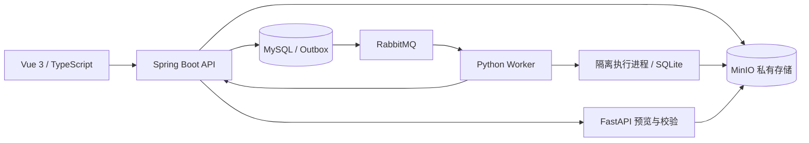

# data-cleaning-pipeline

结构化数据清洗流水线平台：Java 负责业务编排，Python 负责清洗执行，支持文件上传、规则配置、异步处理、脏数据追溯及结果下载。

[](https://github.com/linyuxuan926/data-cleaning-pipeline/actions/workflows/ci.yml)

## 核心能力

- **结构化文件处理**：CSV / XLSX / Parquet，分片上传、SHA-256 校验、续传和预览。
- **磁盘清洗引擎**：SQLite 中间存储，21 类有序规则、字段绑定、精确 Decimal、跨批全局统计与去重。
- **可靠异步任务**：事务 Outbox、RabbitMQ、幂等提交与重试、事件去重、租约恢复、独立子进程取消与超时终止。
- **结果与权限**：可对账报告、来源记录追溯、鉴权下载、服务端游标分页、管理员清理预览与审计。
- **可复现验证**：本地 Java 41 / Python 301 / 前端 14 项测试及端到端验收记录；远端 CI 状态以上方徽章为准。



单机工程项目，容量与部署边界见下文；不将本地验收描述为生产流量验证。

当前 V3 的启动、兼容、磁盘引擎、分页、超时与安全清理说明见[最新交付](docs/V3-COMPLETION.md)。schema3 新规则使用 v3-disk；schema1 历史引擎保持兼容。升级保留原账户、文件、任务和不可变快照。

可部署的结构化数据清洗平台。支持普通用户与管理员、完整性校验与分片上传、CSV 编码 / 分隔符及 Excel 工作表选择、字段预览与类型覆盖、规则版本及完整任务快照、异步任务、日志报告和产物下载。支持 CSV、XLSX、Parquet，采用 Vue 3 / Spring Boot 3 / Python 独立 Worker，以及 MySQL、MinIO、RabbitMQ。

当前已实现磁盘批处理、21 类规则与精确 Decimal、显式逻辑字段绑定及预检、签名游标分页、执行子进程超时、独立 attempt 历史、创建/重试幂等、回调事件账本、结果与脏数据预览、上传恢复和管理员清理计划。清理默认关闭，正式删除需管理员明确启用并执行计划。[上一轮交付](docs/DELIVERY-V3.md)保留为历史验收记录；当前范围与限制以[最新交付](docs/V3-COMPLETION.md)为准，设计文档不能替代运行证据。

数据库迁移已推进至 V8，包含有界清理续扫和持续对象租约；原 V1–V4 未改写。当前 Java 41 项、Python 301 项测试通过，OpenAPI 校验为 68 个操作、65 条路径、153 个模型及 827 个已解析引用。完整部署验收和容量测量以最新交付记录为准。

## 启动

```sh
git clone https://github.com/linyuxuan926/data-cleaning-pipeline.git
cd data-cleaning-pipeline
```

需要 Docker Engine / Docker Desktop（Linux containers）、Docker Compose v2+ 和 Python 3.11+。建议可用 4 CPU、8 GiB 内存、20 GiB 空闲磁盘；第一次构建需要访问依赖仓库。命令均在本项目目录执行：

```sh
python scripts/bootstrap.py
docker compose up -d --build --wait --wait-timeout 180
docker compose ps
```

打开 [http://localhost:8088](http://localhost:8088)，自行注册普通用户。初始管理员用户名和随机密码保存在本地 `.env` 的 BOOTSTRAP_ADMIN_USERNAME / BOOTSTRAP_ADMIN_PASSWORD，无默认密码。`bootstrap.py` 只补齐缺少的配置，保留已有密钥；已有项目升级也应先运行一次。首次构建包含从固定源码构建 MinIO，见部署文档。

新版示例使用 [samples/v3-disk-orders.csv](samples/v3-disk-orders.csv)（另有 XLSX/Parquet）和 [schema3 规则](docs/v3/examples/ordered-rules.json)。页面确认逻辑字段到输入列的绑定并预检后创建任务：8 条输入产生 4 条结果，其中 3 条有效、1 条标记保留；4 条最终移除。旧版 [samples/rules.json](samples/rules.json) 供兼容引擎回归，不能直接作为新版 JSON 导入。真实 API 验收：

```sh
python scripts/smoke_test.py
python scripts/acceptance_v3_disk.py
python scripts/acceptance_v3.py
```

这些正向脚本创建独立测试账号，通过真实 API 验证格式、队列、版本、报告、下载、权限及快照；测试数据保留供核查。会停止服务、改变限额或执行删除的故障脚本应按[测试文档](docs/TESTING.md)仅在独立验收项目串行运行。

## 代码与文档

| 路径 | 内容 |
| --- | --- |
| `frontend/` | Vue 3、TypeScript、Vite、Element Plus；Nginx 同源代理 |
| `backend/` | Java 17、Spring Boot 3、Spring Security、Spring JDBC、Flyway |
| `engine/` | Python 3.11、FastAPI、独立 RabbitMQ Worker、pandas / PyArrow / openpyxl |
| `infra/minio/` | 固定 MinIO 源码构建，规避官方旧二进制分发不可用 |
| [产品设计](docs/PRODUCT.md) | 用户流程、规则语义、验收标准与 MVP 范围 |
| [架构设计](docs/ARCHITECTURE.md) | 边界、消息可靠性、状态机、安全与扩展 |
| [数据模型](docs/DATABASE.md) | 表、约束、索引与迁移 |
| [接口设计](docs/API.md) | 认证、业务与内部协议 |
| [集成契约](docs/CONTRACT.md) | 精确字段、规则、报告和限制 |
| [扩展契约](docs/V2-CONTRACT.md) | 当前管理员、解析、任务快照和多原因协议 |
| [规则参考](docs/RULES.md) | 每种规则的阶段、参数、空值、失败和统计语义 |
| [部署运维](docs/DEPLOYMENT.md) | 配置、构建、启动、排障、备份与升级 |
| [保留期清理](docs/RETENTION.md) | 默认关闭策略、有界续扫、对象租约和删除恢复 |
| [测试与验证](docs/TESTING.md) | 测试命令、覆盖范围和本次实测结果 |
| [当前 V3 交付](docs/V3-COMPLETION.md) | 磁盘引擎、兼容升级、分页、执行隔离、清理边界及实际证据 |

## MVP 容量

单机部署，文件上限 100 MiB，执行上限 500,000 行 / 200 列且总计不超过 5,000,000 个单元格，最多 50 条有序规则。v3-disk 分批读取并使用 SQLite 保存记录、问题和全局索引，逐步输出结果；历史引擎仍保留 DataFrame 路径。每个 Worker 同时执行一个任务，可增加副本；Java 分别控制活跃任务和执行槽，默认全局同时运行 2 个、每用户 1 个。

批次、记录、scratch、产物和超时都有资源预算。XLSX/Arrow 仍有底层缓冲与元数据开销，scratch 检查不是文件系统硬配额；不承诺任意文件大小或恒定 RSS。容量实测状态和限制见[最新交付](docs/V3-COMPLETION.md)。

默认只开放本机 `8088` 端口；页面业务统一访问 Java，Python、MySQL、RabbitMQ、MinIO 均在 Compose 内网。面向外部使用时按部署文档配置 HTTPS 和网络入口。
