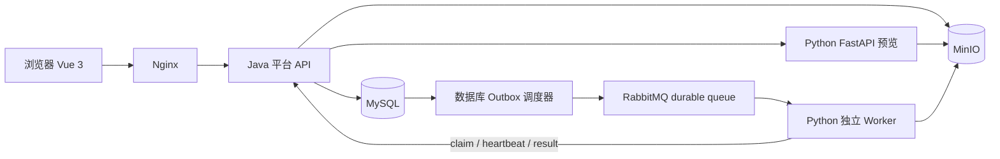
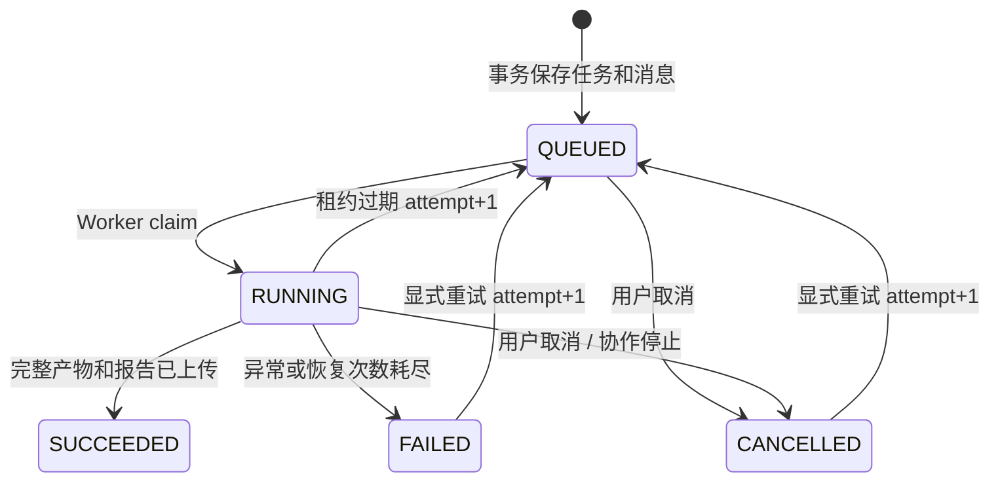

# 技术架构

## 服务边界

Java 是唯一业务入口，负责用户认证、资源归属、分片上传、规则版本、任务状态、限流、并发限制、投递、回调以及授权下载。MySQL 是任务状态的权威来源，RabbitMQ 只负责传递执行指令。浏览器不持有 MinIO 凭据，也不直接调用 Python。

Python FastAPI 处理内部健康检查和有界预览；独立 Worker 手动确认队列消息、获取执行租约、下载文件、验证数据、清洗、生成产物并回报。API 与 Worker 使用相同固定依赖的镜像，通过不同启动命令部署，不在 FastAPI 请求线程内执行清洗任务。

MinIO 保存原始文件、结果、脏数据 CSV 和 JSON 报告。对象键由服务端生成，不接受浏览器指定路径。结果键包含 taskId 和 attempt，避免失败重试或过期 Worker 覆盖新尝试的产物。MySQL 存对象引用及报告 JSON / 摘要；下载时 Java 再次确认用户和任务成功状态后流式读取。

## 消息与执行可靠性

创建任务时在同一个 MySQL 事务中保存任务与 outbox 记录。调度器读取待投递记录，使用持久化消息、publisher confirms 和可路由检查；发布失败继续重试。消息发布成功而数据库更新失败会产生重复投递，由 Worker claim 和状态锁吸收。

队列使用 durable direct exchange `cleaning`、queue `cleaning.tasks` 和 routing key `task`；无法解析的消息进入 `cleaning.dlx` / `cleaning.dead`。Worker prefetch=1，只有终态回调被 Java 接受后才 ACK。连接中断触发 broker 重投；有效租约冲突不能直接 ACK，必须稍后重排队。

claim 以 taskId + attempt 获取一次执行权，并返回 leaseToken。心跳持续刷新租约；Java 拒绝错误 token 和旧 attempt。过期租约由 Java 恢复为新的 attempt 后重新入队，并限制自动恢复次数，防止异常任务永远循环。阻塞计算由 Worker 的执行线程运行，消费线程负责心跳和取消检查，使长任务不会失去 RabbitMQ 心跳。

终态不能被迟到的 RUNNING / SUCCEEDED 消息回退。取消与完成竞争由 Java 锁定任务串行判定；已取消的任务不能下载未被接受的 Worker 产物。`SUCCEEDED` 是完整产物上传及回调持久化后的承诺，单独看到 MinIO 对象不代表任务完成。

## 安全与容量

账号密码采用BCrypt，浏览器使用可撤销且有过期时间的Bearer会话。普通业务查询按当前用户过滤；ADMIN可读取全体任务详情、日志、报告与产物，任务取消/重试及文件、规则操作仍校验本人归属。角色和enabled由Java动态验证，禁用立即撤销会话，最后有效管理员不可降级或禁用。内部HTTP使用独立随机密钥，Compose不开放Python和基础设施端口。Nginx只代理公开业务API，不代理`/internal`。

文件名只用于显示；路径使用服务端 UUID。上传约束分片范围与总大小。读取器校验格式、列数量、行数量及 XLSX 解压体积；另限制逻辑文本、DataFrame 估算内存和实际输出大小，避免重复填充或共享字符串绕过原文件体积限制。规则使用白名单，无任意代码执行。正则限制模式并设置运行时保护；Worker 先验证消息信封，再领取任务并作 Python 权威规则校验，使跨语言正则兼容性错误成为可见的 FAILED，而不会使任务无故滞留排队。电子表格导出对危险公式字符串作安全处理，报告提供提示。

单机内存清洗按文件、行、列和规则数限制资源。用户活动任务、全局活动任务和提交频率在 Java 强制检查。一个 Worker 同时只执行一个任务，可通过增加 Worker 副本扩容，无需额外调度服务。MVP 单 Java 实例使用共享持久卷保存上传暂存，多 Java 实例需先设计跨实例上传和锁策略。

## 一致性边界

MySQL 与对象存储不支持跨系统原子事务：对象上传成功但数据库更新失败可能留下孤儿对象，不影响已完成任务正确性，需要运维按保留策略清理。删除对象前必须确认数据库没有引用，不能简单按前缀年龄删除。MySQL、MinIO 备份需在停止提交和等待活动任务结束后取得一致快照。
