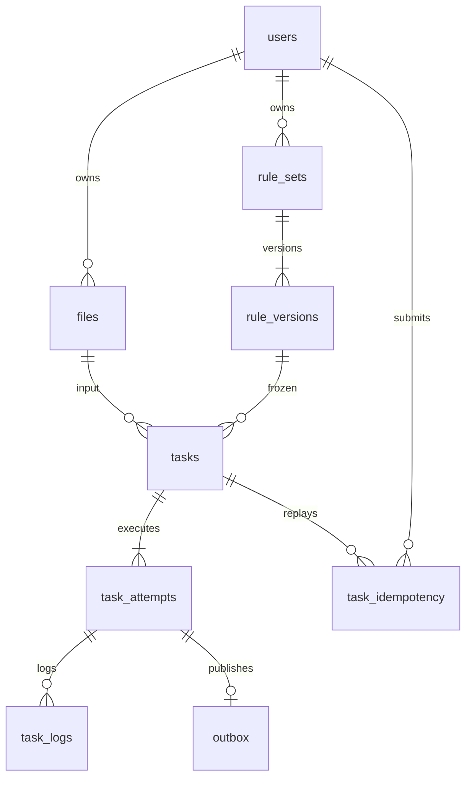

# 数据库设计

当前增量新增V5–V8：rule/task schema_version与逻辑字段/绑定/输出字段快照，files.parse_version；attempt错误/阶段/序号，task_events(event_id唯一、attempt_id/event_seq唯一)、task_operation_keys(user/operation/key唯一)；全列表keyset索引；retention_policy/objects/plans/items/runs与download_leases，清理计划scan_json及范围/审计分页索引。权威DDL见新增迁移，未修改V1–V4。图及兼容/生命周期语义见[最新交付](V3-COMPLETION.md)。

MySQL 8.0，UTF-8 `utf8mb4_unicode_ci`。Flyway在Java启动时执行版本化迁移，权威定义位于`backend/src/main/resources/db/migration/`：初始结构为`V1__initial.sql`，扩展结构为`V2__roles_parse_settings_snapshots.sql`。历史迁移不可修改，后续以新增版本演进。

| 表 | 关键字段 / 约束 | 用途 |
| --- | --- | --- |
| `users` | UUID `id`；`username` 唯一；BCrypt `password_hash`；`role`、`enabled` | 用户、ADMIN/USER角色和启用状态 |
| `sessions` | SHA-256 `token_hash` 主键；用户外键；`expires_at` | 24 小时 Bearer 会话，数据库不存明文 token |
| `files` | UUID；用户外键；显示名、格式、大小、chunk_size、total_chunks、status、object_key | 上传和原始文件元数据 |
| `files` 上传字段 | 独立UUID `upload_id`非空唯一；`expected_sha256`、`sha256` | 分片会话引用、客户端声明摘要和服务端完整文件摘要 |
| `files` 解析字段 | `parse_status`、`parse_error`、`parse_options_json TEXT`、`fields_json MEDIUMTEXT`、`parse_version` | 上传状态与解析状态分离，保存resolved解析选项和稳定字段ID/名称/类型schema；重解析推进版本 |
| `rule_sets` | UUID；用户外键；name、current_version | 规则集当前头版本 |
| `rule_versions` | 联合主键 `(rule_set_id, version)`；name、rules_json | 不可变规则快照及当时名称 |
| `tasks` | UUID；用户、文件、规则版本外键；status、progress、attempt、lease_token、lease_at | 执行控制及恢复状态 |
| `tasks` 报告字段 | `report_json MEDIUMTEXT`、`artifacts_json TEXT`、error | 完整报告（包含行数等摘要）及产物引用，只有成功任务可访问 |
| `tasks` 快照字段 | `rules_snapshot MEDIUMTEXT`、`input_snapshot MEDIUMTEXT`、`limits_snapshot TEXT` | 固定规则数组、原始对象和解析/字段schema、系统设置；重试与恢复沿用 |
| `tasks` schema3字段 | `schema_version`、`engine_version`、`logical_fields_snapshot`、`bindings_snapshot`、`output_fields_snapshot` | 固定引擎、逻辑字段、输入列绑定和预检输出字段 |
| `task_attempts` | UUID `attempt_id`；`(task_id,attempt_no)`唯一；状态、lease、error_code、stage、last_event_seq | 每次执行独立历史；任务当前状态的控制镜像不覆盖终态attempt |
| `task_idempotency` / `task_operation_keys` | 用户+key哈希 / 用户+operation+key哈希唯一；请求哈希、原响应、expires_at | 任务创建与手动重试分别幂等，保留7天 |
| `task_events` | event_id主键；`(attempt_id,event_seq)`唯一；payload_hash、disposition | 回调账本、重放/冲突/乱序和迟到判定 |
| `task_logs` | 自增 BIGINT；task_id 外键；level、message、created_at | 按 ID 增量读取的执行日志 |
| `outbox` | 自增主键；`(task_id,attempt)` 唯一；payload、published | 和任务原子提交的待发布执行消息 |
| `submissions` | user_id、created_at | 每分钟提交次数；按时间清理 |
| `platform_lock` | 固定 `id=1` | 提交、重试和恢复时串行检查全局并发；初始化上传时预留全局暂存额度 |
| `system_settings` | 固定`id=1`；`settings_json TEXT`；`updated_at` | 原9项限额及maxRunningGlobal/maxRunningPerUser执行槽，共11项；旧配置读取时补默认运行槽，管理员调整受代码硬cap保护 |
| `retention_policy` | 固定id=1；policy_json、protected_before | 默认关闭的保留策略及升级前对象保护边界 |
| `retention_objects` | object_key主键；kind、file_id/task_id/attempt_no、state | 对象目录及AVAILABLE/DELETING/DELETED墓碑 |
| `retention_plans` / `retention_items` | 计划UUID、范围与策略快照、scan_json、truncated；候选状态与保护原因 | 管理员dry-run、有界续扫和逐项执行状态 |
| `retention_runs` | 自增id；plan_id/item_id、action、request_id | 删除、跳过和重试审计 |
| `download_leases` | UUID；对象外键；expires_at | 下载及预览租约；活动引用续期、关闭后释放 |

## 索引与事务

新客户端统一使用`/page`签名keyset接口，默认每页20条、最多100条；索引以归属/筛选列加created_at和唯一ID排序。游标绑定用户、范围、筛选、排序和asOf插入截止时间，分页间任务状态仍为当前值。旧普通数组列表最多200条，管理员用户/全局任务最多500条，旧日志增量接口最多500条；均保留兼容并返回弃用及后继链接头。`files_upload_id_idx`是`upload_id`唯一索引，查询同时验证用户归属。任务状态和排队超时使用`(status,updated_at)`；租约超时先按RUNNING过滤再比较`lease_at`，活跃任务默认全局20个、管理员可在硬cap100内调整。outbox使用`(published,id)`扫描，提交频率使用`(user_id,created_at)`。

任务外键引用具体 `rule_versions` 联合主键，保证后来修改规则不会影响已提交任务。创建和重试在同一事务内更新任务、写日志、写 outbox；回调、claim、取消、恢复使用行锁判定并写状态。限流检查持有平台锁，因此同一时刻多个提交不会超出全局活动任务上限。

新建任务固定rules/input/limits及schema/engine；schema3还固定logicalFields/fieldBindings/outputFields，消息只从快照生成。`input_snapshot`包括`fileId/objectKey/format/name/parseVersion/parseOptions/fields`，fields以原位置`f0/f1/...`确定稳定ID；创建时可携parseVersion拒绝过期绑定。`limits_snapshot`保存当时11项系统设置及执行时限、取消宽限，schema3另保存batchRows/maxScratchBytes。重新解析原文件、创建新规则版本和修改配置均不会影响已有任务。V1任务缺快照时只在首次重新入队回填一次；旧文件缺schema时fields为null，由引擎走兼容解析，不能把空数组误当作真实零列schema。

上传分片暂存于持久卷，数据库存总片数和片大小，完成时逐片核验并计算SHA-256；声明了expected_sha256时必须匹配，才写MinIO并提交READY。随后调用Python解析，将parse_status写为PARSED或FAILED，失败仍保留READY原文件和parse_error，可配置后重新解析。仅PARSED允许新建任务。暂存清理在事务提交后进行，数据库失败仍可重复确认合并。文件内容和清洗产物不存MySQL BLOB。

管理员修改用户和系统设置时使用平台行锁串行判定。禁用用户同时删除其sessions，认证查询还关联`users.enabled=TRUE`防止旧会话残留。降级或禁用最后一位启用中的ADMIN返回冲突。注册始终USER，管理员只能从明确环境变量bootstrap或由现有管理员提升；bootstrap不会自动提升已有普通用户。管理员可读全体任务详情、日志、报告及产物，取消/重试仍需任务本人归属；文件和规则权限没有放宽。

JSON快照和配置使用TEXT类型，以兼容迁移与测试数据库；Java/Python在写入前执行结构、体积、语义和硬限额校验，不依赖MySQL JSON隐式转换。新报告使用`inputRows=outputRows+removedRows`守恒，dirtyRows为有问题的唯一原始记录数，issueCount可大于dirtyRows；历史报告缺removedRows时按旧dirtyRows守恒验证。

## 生命周期

用户 token 过期和提交频率记录由调度器定期清理。未完成上传超过24小时转为EXPIRED并清理暂存。业务保留策略默认关闭，升级前对象默认保护；管理员先生成dry-run计划，再显式启用并执行，当前没有周期性自动删除业务产物的后台任务。执行前重新检查当前策略、活动任务引用和下载/预览租约，提交DELETING后才调用MinIO删除，失败保留墓碑供重试。成功删除后对象访问返回410，任务/attempt元数据及报告摘要继续保留；日志可按显式策略单独清理。

V8在retention_plans.scan_json保存扫描统计和签名续扫入口，并为对象目录增加(file_id,object_key)/(task_id,object_key)索引。发现、目录和日志分别有推进游标，每次最多检查1000项，受保护行也推进位置。活动对象租约每30秒续期，关闭和续期互斥；过期非活动租约按最多1000条回收。本地活动引用保护面向单Java节点，续扫及其时间/插入边界见[保留期清理](RETENTION.md)。

V2迁移为既有用户设置USER且enabled=true；为既有文件生成唯一upload_id并设置UNPARSED，原始对象、任务和历史报告保留。既有READY文件需重新解析后再新建任务。旧摘要字段为null，只有V2完成的新上传保证具有服务端SHA-256。生产升级前应备份MySQL和MinIO，并保留Flyway历史表；不要重写已执行的V1迁移或以删卷代替升级。

MySQL 时间按 UTC 存储和传输，前端以用户浏览器时区显示。UUID 用于公共资源标识，仍必须验证资源归属；不可把 UUID 不可猜测性当成权限控制。

## 当前V3增量迁移

`V3__task_attempt_history_and_idempotency.sql` 添加 `tasks.engine_version`、`task_attempts`、`task_idempotency`，并为outbox与日志加入attempt归属。`V4__log_request_correlation.sql` 添加日志request_id。旧库只能回填当前实际保留的一次legacy尝试；V2曾覆盖的历史报告不伪造恢复，旧日志归属保持null。

`V5__cursor_events_schema_and_retry_idempotency.sql`添加schema3/parseVersion/绑定快照、独立automatic_retries、attempt阶段字段、事件账本、操作幂等键和业务列表keyset索引。`V6__retention_catalog_and_audit.sql`添加保留策略、对象目录、计划/候选/审计和对象租约。`V7__retention_audit_cursor_index.sql`增加审计翻页索引；`V8__retention_bounded_scan_continuation.sql`增加清理扫描统计和对象范围续扫索引。

attempt_id UUID主键，(task_id,attempt_no)唯一，历史按此索引查；每条attempt保存独立lease/status/progress/error/report/artifacts及起止时间。日志索引(attempt_id,id)隔离历史。幂等键按(user_id,key_hash)唯一，保存请求哈希与原创建响应，7天过期；平台锁保护同键并发。任务/current attempt作为控制状态镜像在事务中更新，终态attempt不再覆盖。
