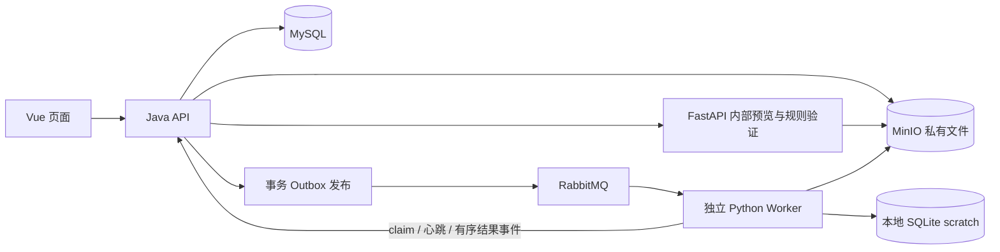
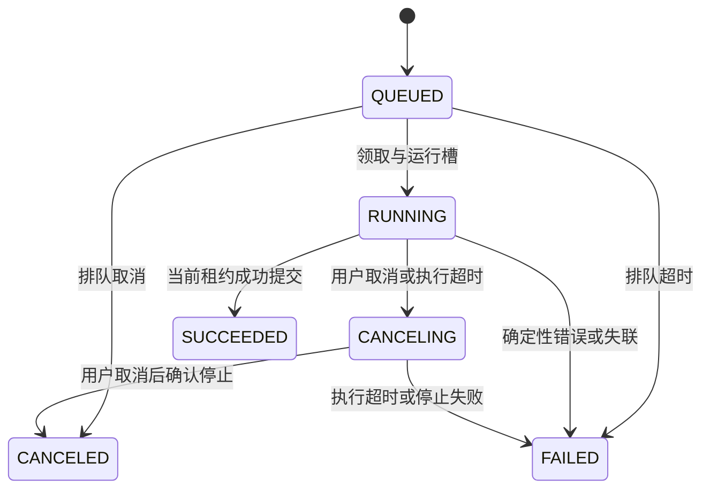

# data-cleaning-pipeline：本轮首轮方案

> 后续实施进展见[最新V3补齐交付](../V3-COMPLETION.md)。本目录保留目标设计及原评审说明，新代码在兼容/api和历史引擎前提下实现，不按设计草案强制替换现有接口。

日期：2026-11-06。状态：**完整目标设计，已实施其中的可运行增量**。实际代码、运行命令、测试结果与未实现项以[当前交付说明](../DELIVERY-V3.md)为准。本文以下保留原评审内容，涉及“待实现”的原始描述不代替交付状态；没有将整个V3目标标为完成。

## 1. 需求理解、默认假设和首版范围

目标闭环为：上传 → 识别字段/解析选项 → 配置规则 → 创建异步任务 → 进度/日志 → 报告 → 预览和下载结果及脏数据。沿用 Java 管业务、Python 管数据、MySQL 管元数据、MinIO 管文件、RabbitMQ 至少一次投递的架构。

首版只做单机 Compose、普通用户/管理员、CSV / `.xlsx` / 扁平 Parquet；不支持 `.xls`、宏文件、密码文件、任意代码、工作流引擎或多节点调度。管理员默认跨用户任务只读，可管理账户与系统限制。CSV 原件保持不变；XLSX 不计算公式。自动类型推断只是建议，不据此转换订单号/手机号/邮编。

重要增量：V2 虽已有真实完整闭环，但**尚不满足**本轮的严格配置顺序、独立 attempt 历史、CANCELING、任务创建幂等、完整服务端分页、上传进度恢复、磁盘流式执行、结果预览、保留期清理及 OpenAPI 交付。新旧能力不得混称。

| 决策 | 本轮默认方案 |
| --- | --- |
| 执行顺序 | 新规则 `engineVersion=v3-sequential` 严格按启用规则数组顺序执行；V2 历史仍用 `v2-phased` |
| 质量动作 | `drop` 立即移除；`mark` 保留并继续收集；`null` 清空失败字段并记问题；不暗中延迟删除 |
| 字段引用 | 规则定义逻辑字段 ID；创建任务显式绑定到所选文件解析版本的 `fN`，提交前模拟字段生命周期并验证缺列 |
| 历史尝试 | 一次重试一个 UUID `attemptId`；旧尝试不覆写，当前 task 指向新尝试 |
| 精确数值 | int64、Decimal，p≤38 / 输入 scale≤12；默认 HALF_UP；JSON 精确小数用类型声明及十进制字符串 |
| 全局规则 | Worker 本地 SQLite 临时盘 + 全任务扫描/索引；不用块内均值/去重替代全局语义 |
| 分页 | `/api/v3`，cursor，默认20/最多100；按 owner、过滤条件、排序键签名，任务状态是查询时实时状态 |
| 幂等 | 创建与重试使用操作级 `Idempotency-Key`；7天内同键同请求返回原资源，异内容409 |
| 保留期限 | 未完成上传24小时、失败/取消产物7天、成功产物30天、原件至少90天、摘要与日志90天；所有删除先检查引用 |

以上为记录的实现默认值，不需要通过不完整的示例去推断业务语义；本轮不执行任何过期删除。

**边界策略：**空/重复列名拒绝，不自动重命名；列名按去首尾空白后的精确 Unicode 字符串判重，保留原始头部用于追溯；空白列名亦拒绝，大小写有别。零字节、只有表头无数据、损坏/真实格式不符明确解析失败，原件若已通过完整性上传仍保留。CSV 记录列数不一致拒绝；编码/分隔符自动识别不确定时要求手动设置。带引号换行的 CSV 单元格仍是一条逻辑数据记录。Excel 只执行一个选定 sheet；数值单元格若已在 Excel 丢失前导零/大整数精度，平台不能恢复，应上传原始文本单元格。Parquet 按 schema/magic/footer 校验，嵌套和二进制列拒绝。

空值统一规定：原生 null/NaN 为缺失；文本 `"NaN"`/`"NA"` 为普通文本，除非列入缺失标记；默认 CSV `""` 是缺失，纯空格不是。`trim` 后得到的空串需再显式 missing 归一。0/false 不是缺失。数值/时间无法转换不得静默变 null；按规则动作记问题。

## 2. 架构与服务职责



Java 负责认证授权、上传、规则版本、幂等、排队/运行槽、状态机、lease、日志/报告入库及鉴权下载；FastAPI 负责有界预览/解析和权威参数校验；Worker 负责执行、全局统计、问题 ledger 和产物。Python 不写业务库、不接收任意 URL。MySQL 是业务权威；MinIO 不公开；RabbitMQ 消息只放任务、attempt 和受控上下文引用。SQLite 是每个 attempt 私有的临时计算文件，随 Worker 发布，不新增基础设施服务。

完整架构、时序和异常路径见 [SYSTEM-DESIGN.md](SYSTEM-DESIGN.md)。继续锁定现有依赖：Java17 / Boot3.3.5 / MySQL8.0.40；Python3.11.10 / FastAPI0.115.4 / pandas2.2.3 / PyArrow18.0.0 / openpyxl3.1.5；Vue3.5.45 / TS5.9.3 / Vite8.3.6 / ElementPlus2.14.7；RabbitMQ3.13.7；MinIO 固定源码版本。SQLite 使用 Python 镜像标准库并记录实际 SQLite runtime 版本；新增数值/排序路径尚待 V3 兼容验证。实施前重跑对应依赖、镜像和安全检查，不把 V2 结果当作 V3 通过证明。

Compose 目标服务为 `frontend/java-api/python-api/python-worker/mysql/minio/rabbitmq`，持久化 MySQL、MinIO、RabbitMQ、Java 上传卷和 Worker scratch；仅开放 frontend。当前仍是原来的 backend/worker 服务名，实施时显式迁移并处理内部地址，不靠隐藏本机配置。

## 3. 数据模型与任务状态机

新增 `upload_sessions/upload_chunks`、`task_attempts/task_events`、幂等键、对象目录/清理任务；规则版本补说明/启用/字段要求/schema/engine；任务保存完整规则/输入解析/绑定/输出/限额快照。报告、日志和产物都关联 attempt。ER、唯一键、外键和查询索引见 [数据模型](SYSTEM-DESIGN.md#3-核心数据模型索引及-er)。



图描述单次 attempt。重试/恢复另建 `attemptId`，旧 attempt 保持终态。取消先锁 task/attempt 并 fencing，旧成功不能越过 CANCELING；只有停止确认后显示 CANCELED。超时沿取消通道停止，但终态 FAILED/TIMEOUT。结果仅在三个产物和 manifest 均通过 Java 校验且事务提交后可用。

V2 已被覆盖的历史报告不能凭空恢复；迁移只登记真实可证实的 legacy attempt，无归属日志保持 unassigned。数据库迁移在后续阶段新增 Flyway 文件，本轮不提交尚未验证的 DDL 到启动迁移目录。

## 4. 规则 JSON 与顺序

[完整规则 JSON](examples/ordered-rules.json) 是本轮唯一八行案例的配置，与 [输入 CSV](examples/input.csv)、[字段绑定](examples/fixture.json) 配套。21类规则的参数、类型、失败、指标、边界及局部输入输出见 [RULE-EXECUTION.md](RULE-EXECUTION.md)。拟采用 JSON Schema Draft 2020-12 + 参数白名单/语义校验，schemaVersion 与 engineVersion 随版本冻结；正式 schema 和 OpenAPI 在阶段0落地验证。

示例执行顺序：

1. trim 客户名；
2. cast 金额 Decimal，失败 drop；
3. 用当前存活记录的全局均值填缺失金额；
4. 检查金额0..200，失败 drop；
5. cast 起止时间；
6. 比较开始时间≤结束时间，失败 drop；
7. 状态枚举，失败 mark；
8. 订单号全局去重，保留最后一条。

该顺序刻意先计算均值再删除异常值：有效金额 `10/1000/12/30/20/40` 的和1112、样本6，填充值185.33。若用户把 range 移到 mean 之前，会改变均值；系统按新顺序执行并记录快照，不自动“修正”。

## 5. 可对账报告 JSON

下例是**设计预期而非执行结果**；真实完整样例存于 [report.json](examples/report.json)，每条规则还有独立计数。耗时不捏造，故保持 null。

```json
{
  "reportSchemaVersion": 3,
  "designExample": true,
  "attemptNo": 1,
  "timing": {"startedAt": null, "finishedAt": null, "durationMs": null},
  "metrics": {
    "inputRows": 8,
    "outputRows": 4,
    "validOutputRows": 3,
    "flaggedOutputRows": 1,
    "finalRemovedRows": 4,
    "duplicateRemovedRows": 1,
    "outlierHandledRows": 1,
    "missingFilledCells": 1,
    "typeConversionFailedCells": 1,
    "issueRows": 5,
    "issueCount": 5
  },
  "finalRemovalByRule": {
    "r02-cast-amount": 1,
    "r04-range": 1,
    "r06-dates-order": 1,
    "r08-dedup": 1
  }
}
```

对账：8输入=4输出+4最终删除，4输出=3严格有效+1标记保留。最终输出来源序号 `[2,5,7,8]`；删除 `[1,3,4,6]` 各有唯一删除规则。问题5条不是5条拒收。`outputRows` 包含 mark/null 保留的问题行，界面另外展示严格有效行数；规则 hitRows 允许重叠。转换失败和填充用单元格单位。来源明细例子见 [issue.json](examples/issue.json)；CSV 序号是逻辑数据记录，不是物理行号。

## 6. 接口清单

V3 基址 `/api/v3`。以下为待实现清单，现有服务尚未发布这些路由；全部列表统一 cursor，错误统一 `application/problem+json`，携带 code/requestId/fieldErrors，下载走 Java 鉴权代理。Python 内部用固定 origin 和独立服务 token。

| 模块 | 接口 |
| --- | --- |
| 认证 | `POST /auth/register`、`POST /auth/login`、`POST /auth/logout`；`GET /auth/me` |
| 系统 | `GET /system/capabilities`、`GET /system/settings`；管理员 `PUT /admin/system/settings` |
| 上传 | `POST/GET /uploads`；`GET/DELETE /uploads/{id}`；`GET /uploads/{id}/chunks`；`PUT /uploads/{id}/chunks/{index}`；`POST /uploads/{id}/complete`、`POST /uploads/{id}/pause`、`POST /uploads/{id}/resume` |
| 文件 | `GET /files`、`GET /files/{id}`、`GET /files/{id}/preview`；`POST /files/{id}/parse`；详情带工作表和字段信息 |
| 规则 | `GET /rule-schemas/{version}`；`POST /rules/validate`；`GET/POST /rule-sets`；`GET/PUT/DELETE /rule-sets/{id}`；`POST /rule-sets/{id}/copy`；`GET /rule-sets/{id}/versions`、`GET /rule-sets/{id}/versions/{version}` |
| 任务 | 幂等 `POST /tasks`、`POST /tasks/{id}/retry`；`GET /tasks`、`GET /tasks/{id}`；`POST /tasks/{id}/cancel` |
| 尝试 | `GET /tasks/{id}/attempts`；`GET /tasks/{id}/attempts/{attemptId}`；其下 `GET /logs`、`/report`、`/preview`、`/artifacts/{kind}` |
| 管理 | `GET /admin/users`、`PUT /admin/users/{id}`、`GET /admin/tasks` |
| 内部 Java | `/internal/v3/tasks/{id}/attempts/{attemptId}` 下 `POST /claim`、`GET /context`、`GET /control`、`POST /events` |
| 内部 Python | `GET /health`；受保护 `POST /internal/v3/preview`、`POST /internal/v3/validate-rules` |

实际 OpenAPI 将逐条列出请求/响应、字段约束、权限、分页、幂等与错误，不用这个缩写清单替代可执行规范。

## 7. 页面和交互

页面：登录；文件列表与解析详情；上传会话；规则库与版本；顺序规则编辑器；任务列表；任务详情/尝试历史/日志；报告与真实结果预览；平台管理。

上传暂停/续传以服务端收片记录为准，刷新后重选同一文件并验证指纹；上传成功与解析成功分开。规则顺序就是执行顺序，保存新版本并显示字段绑定。网络超时复用幂等键确认原任务。取消中继续轮询且不能提前重试。尝试切换后日志/报告/预览/下载全部按所选 attempt；未知总量显示阶段和已处理记录，不编造百分比。详细交互见 [PRODUCT-DELIVERY.md](PRODUCT-DELIVERY.md)。

## 8. 里程碑、依赖和验收

| 阶段 | 交付/依赖 | 退出门槛 |
| --- | --- | --- |
| 0：本轮设计及契约细化 | 本轮文档、样例；随后版本化 schema/OpenAPI/新增迁移方案 | 文档/JSON结构及对账检查；参数命名、状态和版本边界一致。正式契约测试尚待实施 |
| 1：完整纵向流程 | 从第一天纳入权限、attempt、快照、幂等、outbox；新增上传会话/预览、基础规则执行、报告下载和页面 | 空库与旧库升级、真实三格式浏览器流程、正确输出/报告、同键并发只创建一次、越权拒绝；不可用模拟数据补功能 |
| 2：可靠性与追溯 | 依赖阶段1协议；取消/重试、历史、重复乱序事件、恢复、完整分页、脱敏日志与保留期清理 | 真 kill Worker/broker/Java、回调暂败、旧尝试/取消竞争、页边界、上传恢复、部分对象删除失败均可复现验证 |
| 3：容量、安全和部署 | 依赖前两阶段可部署产物；流式及全局磁盘路径优化、资源测量、备份恢复、最终文档 | 公布机器/资源限制、文件字节/行列、规则、并发、耗时、峰值RSS/临时盘、正确性；全新Compose启动与示例；未测不声称通过 |

全局正确算法从阶段1按磁盘策略设计，阶段3只优化/测量，不推翻顺序和快照。Java/DB 先冻结控制契约；Python 与前端可围绕同一版本契约并行开发，阶段完成必须在真实服务上串联验收。每阶段报告固定包含“已实现、运行命令、实际验证、已知问题、下一步”。

## 9. 风险及验证

| 风险 | 验证方法 |
| --- | --- |
| 严格顺序改变旧结果 | 同输入分别跑旧/新引擎；旧重试黄金结果不变；新顺序交换用例明确产生不同预期 |
| 统计/keep-last跨块错误、Decimal损精度 | 多种batch大小、重复跨首尾块、全空/平局/边界/2^53以上整数与Decimal精确oracle对比 |
| 磁盘与内存放大 | 单记录/解压/shared strings/大量issue/高基数去重；测scratch+RSS，满盘及超预算明确失败 |
| 取消和事件乱序 | 同eventId重放/异内容、低seq、高seq旧attempt、取消与产物提交竞争、deadline子进程停止确认 |
| 消息/数据库/对象非原子 | confirm丢失、DB提交失败、对象已写但回调失败、重启后只接受一个有效attempt产物 |
| 保留期误删活跃数据 | active引用保护、两阶段删除中断、重复清理、过期410及非owner404、孤儿登记对账 |
| 安全 | 替换每种资源ID、SSRF、路径穿越、zip bomb、正则超时、CSV公式防护；普通日志不出现原值 |
| 旧历史已被覆盖 | migration仅回填可证实记录；无法归属日志明示；不得用虚构attempt凑历史 |

以上风险表和方案保留原评审时的目标范围。已有V2的测试数量和164.9秒恢复记录只说明原版回归基线；当前V3增量已另行执行功能、故障和小样RSS验证，见[当前交付说明](../DELIVERY-V3.md#本轮实测记录)。流式磁盘执行仍未实现，不宣称流式容量或生产吞吐已验收。
