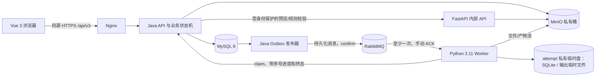
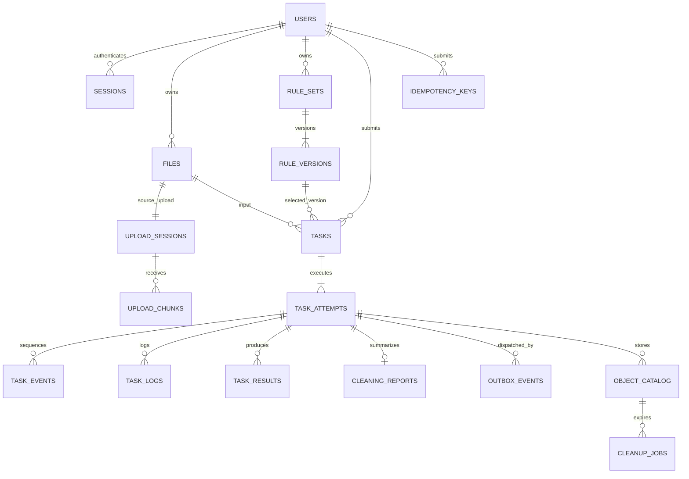
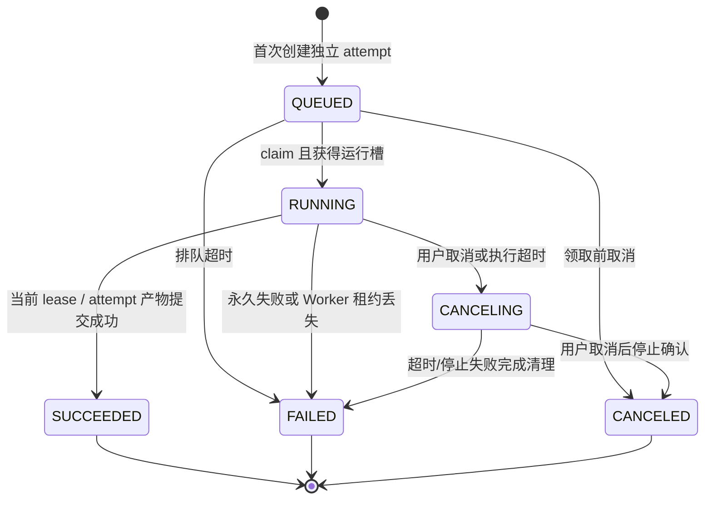
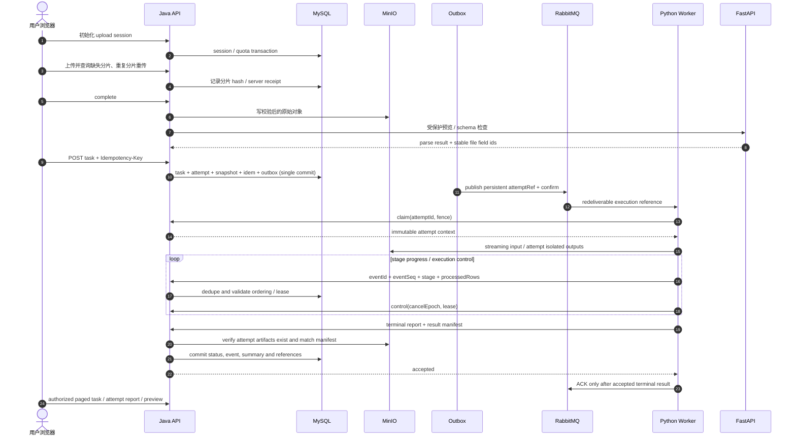

# V3 端到端方案（评审草案）

> 实施状态更新（2026-11-06）：以下保留原始目标方案及当时的V2现状描述。当前已有V3增量代码并完成本地运行验证，实际范围见[交付说明](../DELIVERY-V3.md)；不能依据下文的“尚未实现”清单判断当前代码，也不能把设计中的SQLite、分页等目标当成已实现接口。

**状态：V3 评审草案，不代表下列 V3 行为已在现有系统实现或验证。**当前可运行系统是 V2：它已有真实 Java / Python / MySQL / MinIO / RabbitMQ 流程、三种格式、分片、认证、规则快照、事务 Outbox、尝试租约和下载。它的列表截断、阶段排序、任务内重试覆盖、立即终态取消及内存型清洗与本草案要求不同。本轮提交的是方案、契约样例和验收设计，不更改现有运行代码。

本草案保留已验证的 Vue 3 / Java 17 / Spring Boot 3 / Python 3.11 / MySQL 8 / MinIO / RabbitMQ / Docker Compose。FastAPI 只做健康检查、受保护的预览和规则验证；独立 Worker 从 Java 读取执行上下文并执行任务。Compose 服务接口命名建议明确为 `java-api`、`python-api`、`python-worker`，可通过服务别名平滑兼容当前 `backend` / `worker` 名称。消息仍由一种队列 RabbitMQ 承载。

## 1. 需求理解与范围

首版以可追溯、执行顺序明确、资源有界的结构化文件清洗为目标。输入格式限定 CSV、无宏/无密码的 OOXML `.xlsx`、扁平标量 Parquet；不承诺 `.xls`、`.xlsm`、公式求值、密码文件、嵌套或二进制 Parquet 列、跨集群执行，也不在未测前承诺多 GB 文件或吞吐。Java 始终是浏览器业务入口和任务状态权威方；Python 不写 MySQL。MinIO 私有桶通过 Java 的权限校验和流式代理访问。

初始可配置的容量上限沿用已存在的输入文件、行、列、单元格、工作表展开体积和预览限制；新增上传占用、运行槽位、排队容量、单任务超时、取消宽限、scratch 磁盘容量和产物保留期须分别设置硬上限及默认值，并通过下述容量测试后才能作为已支持范围公布。上传/任务分页初始 `pageSize=20`、最大 100；全局扫描严格按规则执行序列运行，不按分块各自计算统计量。

这次相对 V2 明确增加的行为包括：新规则按配置数组严格顺序执行；创建支持幂等键；任务有稳定的执行尝试 ID 和不可变历史；取消有 `CANCELING` 中间态；所有列表使用服务端游标分页；上传状态和服务端收片进度可恢复查询；CSV / Parquet 逐块读取并用每次 attempt 隔离的 SQLite 临时索引处理全局操作；执行失败与最终移除来源可逐条追溯。现有 V2 阶段规则另以 `engineVersion=v2-phased` 保持历史执行语义，不在迁移时静默重排。

**需求验收判定：**目前已有真实三格式上传、解析 / 预览、V2 规则处理、异步执行、鉴权下载、任务和规则快照；这些仅覆盖原先验收项。V3 幂等、独立 attempt 历史、`CANCELING`、严格顺序、全量分页、断点上传查询、磁盘全局规则执行、新报告口径和生命周期清理尚未实现，必须按第10节里程碑分别验收。

## 2. 架构与消息时序

1. 浏览器向 Java 创建上传会话；Java 将会话及预期元数据写 MySQL，分片暂存在同一后端的持久临时卷。只有服务端确认的片能计入进度。完成请求验证片序号、片长、总长和流式 SHA-256，验证成功后才把原件保存为私有 MinIO 对象，记录服务端摘要，再通过受保护的 Python 预览校验完整格式和解析选项。解析失败保留 raw 原件，文件不可提交任务。
2. 浏览器在一次真实提交时生成一次 `Idempotency-Key`。Java 校验所有权、文件解析版本、已启用的规则集及字段绑定，构造不可变 input/rule/engine/resource 快照及 hash，然后在**单一 MySQL 事务**中写逻辑任务、首个 attempt、幂等映射和 outbox。
3. Outbox 发布精简消息 `{schemaVersion,taskId,attemptId,contextRef}`，使用持久化 delivery、publisher confirm 和 unroutable 检查。contextRef 是受控 ID 而非任意 URL。Worker 校验 envelope 并向固定 Java origin claim。Java 按 lease/fence token 决定唯一有权执行的 attempt，并通过内部上下文 API 返回该次任务固定快照。重复消息仍可能送达；过期 attempt 或重复 claim 不会产生可接受的第二个成功结果。
4. Worker 从 MinIO 分块读取并按规则顺序执行；逐行段流入有界 record batches。需要全局信息的步骤在当前规则位置把尚存活的行 spool 到 attempt 私有 SQLite，再做全范围统计/索引计算并顺序输出。Worker 仅在受安全配置授权的对象键空间生成按 attempt 隔离的产物；使用同一个 task/attempt 时，结果、脏数据、完整报告和 attempt manifest 的 hash、大小先校验，再发送 Java terminal event。
5. Worker 的阶段进度和终态事件携带 `attemptId + leaseToken + eventId + eventSeq + requestId`。Java 校验当前 attempt、租约和状态转移，幂等记录事件，并写入不可变历史报告/产物引用；只有 MySQL 成功接受终态后 Worker 才 ACK。进程异常则不 ACK，租约到期由 Java 关闭旧 attempt 并按有界策略新建一次恢复 attempt；不会把旧 attempt 改回 QUEUED。
6. 取消通过 Java 写入 `CANCELING` 和 cancel epoch；Worker 在读入、每一条规则/分批边界、全局 SQLite 扫描和各产物阶段查询取消。清理未发布的临时对象后，Worker 回报 CANCELED。若 Worker 失联，在取消宽限和租约/执行 fencing 确认旧 lease 已失效后，Java 只可关闭该次 attempt 的有效提交权；进程停止状态与业务 fencing 分开记录，不把“取消请求已接收”误报成“进程已停止”。

以上提供**至少一次消息投递和幂等状态变更**，不宣称恰好一次计算。对象存储与 MySQL 没有跨系统事务：先写对象后提交数据库仍可能留下孤儿。用对象目录清单、删除任务和定期引用对账安全回收，不按对象前缀的年龄直接删除。

角色权限保持一套明确矩阵：USER 操作本人文件、上传会话、规则、任务与尝试；ADMIN 管理账户/限制且可读取全部任务、日志、报告和产物，跨用户任务的取消/重试默认禁止。上传/raw与规则不会因管理员角色自动开放任意访问。Python 只持内部服务身份，不具备任意业务用户授权身份。对象键只能由服务端登记的引用解析，不接受外部 URL、存储 endpoint 或用户 SQL。

## 3. 核心数据模型、索引及 ER

新增和演进由 MySQL Flyway 新版迁移完成，不重写已执行的 V1/V2。业务 JSON 与报表使用版本字段、体积约束及契约校验。下图为逻辑模型，外键和删除行为仍以提交实施的迁移及索引审查为准。

| 表 | 主要责任和字段 | 关键约束 / 查询索引 |
| --- | --- | --- |
| `users`, `sessions` | 现有启用账户、会话与角色；角色授权动作写权限矩阵 | 唯一用户名；会话 token 只存 hash；最后有效管理员保护 |
| `files` | 文件 owner、显示名、声明格式/size、服务端 SHA-256、对象键、parse 状态、schema、parseVersion | `(owner_id,created_at,id)`；owner 每个请求都检查 |
| `upload_sessions` | 独立 session UUID、owner/file、总字节、expected digest、chunkSize/count、receivedBytes、状态、过期时间、revision | `(owner_id,state,created_at,id)`、`(state,expires_at)`；完成后file独立保留；会话过期不能误删已完成raw对象 |
| `upload_chunks` | upload session、0-based index、服务端实际 byte length、SHA-256、完成时间和暂存位置 | `UNIQUE(session_id,chunk_index)`；重复相同 chunk hash 幂等；不同内容重传409；需放弃该会话重新初始化，避免并发覆盖 |
| `rule_sets`, `rule_versions` | owner、name、description、enabled、软删除及 creator/updater；不可变 version、schema/engineVersion、字段要求、ordered rules、hash | `UNIQUE(rule_set_id,version)`；被 task/attempt 引用的版本不可物理删除；rule set 停用不影响旧快照 |
| `tasks` | 逻辑任务、owner、文件/规则头部引用、完整不可变 context snapshot + hash、幂等 key 引用、当前 attempt ID、任务派生状态和时间 | 当前 attempt 单点；owner 与查询过滤的排序复合索引；事务创建 task + attempt + idempotency + outbox |
| `task_attempts` | 不可变 attempt UUID、task/attemptNo、触发来源、engine version、状态、lease/fencing epoch、worker、阶段/行数、起止/截止时间、取消原因、错误和报告引用 | `UNIQUE(task_id,attempt_no)`；lease index；新重试 `INSERT`；旧 attempt 不覆写 |
| `task_events`, `task_logs` | 带 eventId/eventSeq/requestId 的事件账本，脱敏后的可读日志和阶段 | `UNIQUE(attempt_id,event_id)`、`UNIQUE(attempt_id,event_seq)`、`(attempt_id,event_seq,id)`；消息 payload / 日志不得包含完整敏感单元格 |
| `task_results`, `cleaning_reports` | 每个 attempt 各自结果/脏数据/JSON 报告的受控 MinIO 引用、hash、字节数、摘要、可用期 | `UNIQUE(attempt_id,kind)`；attempt 隔离且授权路由只访问所选 attempt |
| `outbox_events`, `idempotency_keys` | 可靠消息发布记录；请求 key hash / canonical request hash / taskId / 首次响应 / 到期时间 | `UNIQUE(attempt_id)`；`UNIQUE(owner_id,operation,key_hash)`；消息发布条件扫描索引 |
| `object_catalog`, `cleanup_jobs` | 原始和 attempt 对象 intent、引用、保留截止、删除状态、可重试工作 | `(status,expires_at,id)`；先标记待删、确认无 active 引用，再幂等删除对象 |
| `system_settings` | upload / queued / running / timeout / scratch / retention 各容量设置 | singleton row lock 保持单机限额检查正确；所有值有代码硬上限 |

任务列表、文件、规则、用户、attempt、报告和日志均使用服务端分页。拟定统一返回 `{items,nextCursor,hasMore}`。默认一页 20、硬上限 100；签名 cursor 绑定 owner / admin scope、全部过滤器、排序方向及 `(createdAt,id)`，不能由客户端任意编辑；同 timestamp 由 UUID 稳定打破平局。任务过滤有状态集合、左闭右开的 `createdFrom`/`createdTo`、转义后的 literal 文件名子串、管理员 owner；排序仅允许预先声明的列。cursor 保存首次查询的 asOf 时间以限制后续新插入记录；任务状态过滤是查询时实时状态，不承诺跨页面冻结状态快照。刷新重建查询。不在截断结果集上做前端过滤。

## 4. 状态机、取消与尝试历史

API 状态只使用 `QUEUED`、`RUNNING`、`CANCELING`、`SUCCEEDED`、`FAILED`、`CANCELED`（固定单 L 拼写）；迁移可识别旧 V2 `CANCELLED`，但 V3 响应只发 `CANCELED`。逻辑 task 对外呈现当前 attempt 状态；每次人工重试或真实的 Worker 失联重排均分配新的 UUID `attemptId` 与递增 `attemptNo`，并保留先前尝试报告、错误、日志、时间与产物引用。

图描述**单个 attempt**，终态不可再次进入 QUEUED。允许重试时，Java 在另一个事务原子 INSERT 新 attempt(QUEUED) + outbox，并更新 task.currentAttemptId；自动恢复亦先关闭旧 attempt(WORKER_LOST)再新建。任务层状态随当前 attempt 改变，旧 attempt 保持终态。

运行中的取消先由 Java 记录 `CANCELING`；此时仍占用运行槽，不允许重试或下载当前 attempt 产物；重复取消返回同一取消状态。队列尚未 claim 的取消可安全直接落 CANCELED；已经 RUNNING 则先做协作取消；Worker 监督进程在宽限内确认执行子进程退出，必要时终止子进程并清理。租约 fencing 只保证旧计算不能提交有效结果，不代表操作系统进程已停止；失联运行槽直到 Worker 断连及租约过期后释放，仍存活的执行子进程须由监督进程的心跳/最大运行时自停，不把 fenced 状态伪称已停止。完成与取消竞争以 Java 行锁事务的先后为准：成功先提交则取消返回状态冲突；取消先提交则进入 CANCELING 并拒绝任何成功事件，eventSeq 再大也不能越过该状态门禁，CANCELED 后任何 SUCCEEDED 心跳或旧 attempt 结果都不会改变状态。底层单次解压、系统调用或网络读可能延迟到调用返回；取消 SLA 由 `cancelGrace` 测试给出，未测前不承诺即时中止。

短暂网络/对象存储故障才可按有限次数、指数退避、随机抖动自动新建 attempt；文件损坏、规则/Schema 错误永久失败，不自动重试。`WORKER_LOST` / deadline / 取消清理失败须有稳定 error code 和人工可读摘要。任务级 `maxAutomaticRetries` 与总 attemptNo 分离，避免用户反复手动重试之后仍不断自动恢复。

取消确认无法获得时，不用业务 fencing 冒充执行已经停止：在宽限及 lease 到期后以 `FAILED/CANCEL_UNCONFIRMED` 明确结束旧尝试，并拒绝其产物；不对用户显示已确认 CANCELED。执行监督进程为子进程维护本地单调租约到期时间，无法续租即停止执行；本机 deadline 到达也必须终止子进程。子进程退出确认后才能由监督进程报告 CANCELED。超时使用相同停止通道，记录 FAILED/TIMEOUT。以上停止策略须在阶段2真实故障验证。

**历史迁移边界：**V2 的手动重试原地清空上一份报告、artifact 引用和 error，历史日志也没有可靠 attempt 外键。迁移只可依据现存 task 当前状态、当前快照、实际仍在且 hash 可核验的报告/对象登记一个 `legacy` attempt；无法安全归属的旧日志标为 `legacy/unassigned`。不能恢复已被覆盖的 retry 记录或声称完整重建了 V2 历史。从启用 V3 的迁移点开始才承诺每次尝试均单独可查询。

## 5. 任务幂等、可靠事件和资源槽

- `POST /api/v3/tasks` 和 `POST /api/v3/tasks/{taskId}/retry` 必须接收独立操作域的 `Idempotency-Key`。同用户、同操作、同 key、同 canonical request hash 返回200及原 task/attempt；首次返回201；key 相同但请求不同则 409 `IDEMPOTENCY_KEY_REUSED`。幂等命中先于额度扣除；真正新 task/attempt/outbox/key 仍以单事务提交。建议 key/response 保留 7 天；过期不再保证幂等。
- Canonical request hash 只根据调用者原始显式请求（fileId、parseVersion、ruleSetId/version、字段映射、输出/engine/schema选项）计算，不因后来文件重解析或系统限额改变而重新求值；实际解析的快照 hash 在首次事务中单独冻结。key hash 与请求内容分开，日志不得记原明文 key。重复点击/客户端超时重发复用原 key；明确重新运行才新建 key。
- Outbox 创建时追加 event，不更新/复用某个旧 attempt 的已发布行。RabbitMQ 消息只带 schemaVersion、taskId、attemptId、contextRef 和必要的 trace ID，不携带文件 bytes、全部规则或凭据；Worker claim 后从受保护 Java internal API 获取不可变上下文。
- Worker 为单 attempt 串行发出事件序列。每条有 UUID `eventId`、正整数 `eventSeq`、`requestId`、attemptId、lease/fencing token、状态/阶段和处理行数。相同 ID/hash 重发视为幂等重复；同 eventId/seq 不同 payload 为协议错误；迟到低 seq 可以审计但不得续租、倒退阶段/计数或改终态；错 lease/旧 attempt 永不生效。
- 进度 `{stage,ruleId?,stageProcessedRows,totalRows?,startedAt,heartbeatAt}` 描述当前阶段而非累计唯一行；未知行数为 null。仅当此阶段总量已可靠统计才显示 stage 百分比；由服务端 timestamps 计算耗时。转换、扫描、写输出按可观察阶段上报，不能用固定伪百分比假装总体精确完成率。
- 分别配置 global/per-user `maxRunning`、global/per-user `maxQueued`、每用户 submit rate、deadline、cancel grace 和自动重试上限。claim 原子占运行槽；有空闲 Worker 但无槽时延迟重排队（固定退避，避免紧密 NACK 循环）；terminal 成功/失败/取消和已 fencing 的过期任务才释放槽；排队和运行限额分别校验并可观测。多 Worker 副本通过 Java DB 锁 / claim 控制；不为单机 MVP 引入 Redis。
- 每个 HTTP 入口生成或校验 bounded `X-Request-Id`，贯穿 Java/Python 请求、outbox、事件、attempt 日志和问题关联。日志默认记录字段 ID、规则 ID、错误码和行序号，不记录敏感原始值。

规则执行和解析资源上限来自任务创建时快照；当前账户权限、平台运行槽、排队接纳和提交频率始终按当前配置再次检查。更改后者可以限制旧任务重试进入队列，但不得改写它的清洗参数或输入快照。

### 拟定运行默认值

这些值作为首轮实现起点，**尚未证明该边界的数据一定可在此资源内成功完成**；超预算失败不扩大限制，阶段3按实测下调或发布容量。管理员设置只能在镜像中定义的硬上限内修改，硬上限必须经专项验收才能提高。

| 配置 | 首轮提议默认值 | 约束和计数含义 |
| --- | --- | --- |
| 输入/执行限制 | 100 MiB、500000行、200列、5000000单元格、XLSX展开512 MiB | 解析或读取到可判定时最早拒绝；先保留V2的代码安全上限，不当作实测容量 |
| 预览 | 默认100，允许管理员下调，硬上限1000行 | 每次有界读取；不对CSV/XLSX声称已扫描全文件 |
| 上传 | 分片4 MiB，允许256 KiB–8 MiB；每文件2个并发分片，最多4；客户端最多2个并行文件 | 服务端校验每用户总在途请求；相同片相同hash重传幂等，不同hash返回409并要求新会话 |
| 上传暂存 | 每用户20会话/512 MiB，全局200会话/5 GiB | 初始化预留，合并副本另计磁盘预算；数据库和本地片定期对账 |
| Worker运行槽 | 全局2、每用户1；初始部署1个Worker | claim限制实际运行attempt；增加副本不突破全局槽 |
| 排队 | 全局20、每用户3、排队最长1小时 | 独立于运行槽；每用户每分钟新建/重试10次，幂等重放不重复计入 |
| 时间 | heartbeat10秒、lease120秒、执行timeout30分钟、cancelGrace30秒 | 超时实际停止，不自动恢复确定性的超时任务；各阶段原生调用延迟单独测试 |
| 恢复 | 每任务最多2次自动恢复；服务调用3次/总预算120秒内退避 | 瞬时网络错误可重试；校验/损坏/类型等确定错误不重试；backoff与jitter上限60秒 |
| 分批 | 最多10000条或解码后16 MiB，先到为准；单记录1 MiB、单字符串256 KiB | 这些是传输/处理批预算，不等同Python RSS；XLSX另外遵守32767字符单元格限制 |
| 本地scratch | 每attempt2 GiB、平台6 GiB，包含SQLite/索引/日志/输入缓存/各输出 | 写前预测和写后计量；超限RESOURCE_LIMIT，不截断；实时磁盘剩余不足也拒绝 |
| 进程资源 | 每Worker容器拟设2 GiB内存，执行子进程1个 | OOM与native reader超额明确失败或失联恢复，不能靠此配置承诺任意文件成功 |

上传会话状态统一为 `UPLOADING/PAUSED/COMPLETING/COMPLETED/FAILED/ABORTED/EXPIRED`。PAUSED 保留已确认片、释放请求并发；恢复返回 UPLOADING。网络单片失败仍是UPLOADING，不自动把整个会话写FAILED。合并使用会话revision与状态锁，COMPLETING只允许读进度，超时合并由调度器确认执行权后恢复或失败。COMPLETED 与文件parseStatus分离，解析失败不会把已完整保存的原件回滚成上传失败。

## 6. 清洗执行与报告

每条新规则通过版本化 JSON Schema/等效契约进行类型、未知属性、默认值和跨字段约束校验。schema 同时驱动 `/api/v3` 参数描述，Java 提交前调用内部权威校验；Python 使用只读 handler registry 实现已发布规则，不允许由请求添加 handler、表达式脚本、Python / SQL / shell。所有 handler 声明字段约束、前置条件、空值语义、动作、统计口径、资源级别及例子。

V3 新规则保持数组顺序。`drop`（拒收）在该条规则完成后立刻将来源记录移出后续规则；`mark` 保留记录并积累多条 issue；转换失败的 `null` 清空指定单元格并留 issue，不删除该行。若用户要收集一行全部错误后再统一拒收，必须显式定义一条末尾质量过滤规则；不得以验证阶段批量收集的隐藏延迟打破严格执行顺序。错误处理和报告详情见 [规则执行规格](RULE-EXECUTION.md)。

CSV 用可跨引号换行的流式 reader 按逻辑记录序号处理，Parquet 采用 Arrow RecordBatch；batch 同时有行数/字节和单行字节限制。`.xlsx` 用 `openpyxl` read-only / 受限解压体积，只选定一个 sheet。提交任务前绑定且验证所有字段需求；未知列、丢失列、冲突类型和不支持压缩应清楚报错。

逐行操作可逐块处理。全局步骤不得分别计算分块统计量：在执行序列遇到全局 fill mean/median/mode、IQR 或 keep-last 时，将该点当前 survivors 写入本 attempt 私有 SQLite scratch 并建受限索引，经过必要的额外全局扫描再保持来源顺序写出。SQLite 仅用于临时索引/ledger，不是业务库；不能用 SQLite REAL/Numeric 或 float 存储有精度要求的 Decimal。V3 先定义精确十进制域（建议最多 38 位有效数、最多 12 位输入小数），`sum/count` 在 Decimal 局部上下文计算，中位数/IQR 用定长的有序十进制 sort key 做全局排序/取秩；众数按类型化值与最早来源序号破局，keep-last 建“全局键→最大来源序号”再第二遍输出。任何 spill 都受单 attempt 磁盘配额、取消点、保留和崩溃清理约束；SQLite sort 方案必须先针对真实样本压测确认成本。

## 7. 计数、问题来源和 retention

CSV `sourceRecordNumber` 是 1-based **逻辑数据记录序号**，首行为表头且不计数；字段中被引号包围的换行不会增加记录号。Excel 问题包含 sheet 名和数据记录序号；Parquet 含 row-group/全局 row ordinal 的确定映射。稳定 `recordId` 基于 `fileId + parseSnapshotHash + sheetName? + sourceRecordNumber`，同一不可变任务内重试得到同一标识。

每条脏数据/数据质量 issue 为事件，包含 `fileId/sheetName/sourceRecordNumber/recordId/ruleId/fieldId/sourceFieldName/beforeValue/errorCode/reason/actionAtRule/finalAction/removedByRuleId?/attemptId`。处理前原值仅写权限受控产物，不写常规日志。转换 null/mark 继续加工时，下游可追加新 issue；最终结果可从每条问题回溯规则动作。

报告的核心计数口径：

- `inputRows`、`outputRows`、`validOutputRows`、`flaggedOutputRows`、`finalRemovedRows` 都是**数据记录行数**（不含表头）。保留标记行仍包含在 outputRows 中。满足 `inputRows = outputRows + finalRemovedRows` 和 `outputRows = validOutputRows + flaggedOutputRows`。
- 每个被移除来源记录唯一归到首个实际将它从 survivors 中移除的规则；`finalRemovalByRule` 互斥，`duplicateRemovedRows` 为明确去重事件的子集。每条规则的 `hitRows` / `issueCount` 可重叠，不能相加成独立记录数。
- `outlierHandledRows` 的单位为唯一来源记录、对不同 outlier rule 可重叠；标记/置 null 不代表已移除。`missingFilledCells`、`typeConversionFailedCells`、`changedCells` 分别按每次“规则×来源记录×字段”的事件或成功改变的单元格统计；各有说明中的计算分母。
- 每条规则报告输入存活行、规则触发行、issue、null/mark/drop 动作数、最终唯一归因数、成功改变单元格及全局统计 sample/exclusion/threshold。`durationMs` 从 attempt 开始/成功由服务端 UTC 时间计算；失败/取消也保留执行和清理耗时。

### retention 评审默认值

下表是需要在 V3 规格评审中确认的**提案值**，不是现有行为或已部署的合规保留策略：

| 数据 | 提议保留期 | 删除条件 |
| --- | --- | --- |
| 未完成 upload session 与 chunk | 24 小时 | expired、非COMPLETING、无任务引用；先完成 session tombstone，再清理本地 chunk |
| 临时执行 / 成功与失败 attempt scratch | 成功/取消后立即尝试清理；崩溃遗留目录按本地宽限对账 | 确认 worker 不再持有 attempt lease，禁止清理 live attempt |
| 失败/取消的结果或部分产物 | 7 天 | 无下载/审计保全策略引用；保留 attempt 元数据和 artifact manifest tombstone |
| 成功结果、脏数据和完整报告对象 | 30 天 | attempt terminal、无 active 引用；过期下载明确 410 |
| 任务/attempt 元数据、报告摘要及审计日志 | 90 天提议，可独立调整 | 归档检查、规则/合规 hold、文件引用核查完成后软删除 |
| 幂等响应映射 | 7 天 | 期满只结束幂等承诺，不删除仍被任务/attempt 使用的业务记录 |
| 原始输入文件 | 至少 90 天提议；长于任何活跃任务/人工可重试窗口 | 无正在执行/可重试的引用且 raw 保留到期，才允许标记与清理 |

raw对象已过期时重试返回410/INPUT_EXPIRED，不生成必然失败的新attempt；规则/引擎快照仍可查看。幂等重放若引用的业务元数据已到期，同样返回已过期的tombstone，不创建替代任务。

对象回收按“登记 intent/引用 → 到期软标 DELETING → 再查 active attempt/任务/raw 引用 → MinIO 幂等 delete → 记 DELETED”推进，部分失败可退避重试。活动任务的 source object、有效结果和取证保存不得由宽泛 lifecycle 规则自动删除。MinIO 生命周期仅可用于经引用对账后隔离的 staging namespace。

## 8. API v3 清单及 OpenAPI

所有 V3 浏览器接口通过 `/api/v3`，内部接口使用不可向公网暴露的 `/internal/v3`。业务错误统一 `application/problem+json`：`{type,title,status,code,detail,requestId,fieldErrors?}`；认证/授权/资源不存在响应不泄漏他人资源信息。对象存储访问永不返回长期 bucket URL。项目根新增正式 `openapi/v3.yaml` 后才能声明 OpenAPI 交付完成；当前本节是评审清单，非已发布规范。

| 范围 | HTTP 方法 / 路径 | 职责与要求 |
| --- | --- | --- |
| 身份与我的信息 | `POST /auth/register`、`POST /auth/login`、`POST /auth/logout`、`GET /auth/me` | 注册固定 USER；会话可撤销、过期、禁用失效；错误结构含 requestId |
| 系统能力 | `GET /system/capabilities`、`GET /system/settings`、`PUT /admin/system/settings` | 返回支持格式/限制/规则 schema version；管理员调硬上限内配置 |
| 文件与上传会话 | `POST /uploads`、`GET /uploads`、`GET /uploads/{uploadId}`、`GET /uploads/{uploadId}/chunks`、`PUT /uploads/{uploadId}/chunks/{index}`、`POST /uploads/{uploadId}/complete`、`POST /uploads/{uploadId}/pause`、`POST /uploads/{uploadId}/resume`、`DELETE /uploads/{uploadId}` | owner-checked session，分页收到/缺失片、received bytes、SHA、状态、revision、expire 时间；完成校验；可断点续传/中止 |
| 文件操作 | `GET /files`、`GET /files/{fileId}`、`GET /files/{fileId}/preview`、`POST /files/{fileId}/parse` | 全量 cursor 分页；详情含上传/解析/来源 schema；受限 preview；明确 encoding/delimiter/sheet/type overrides |
| 规则 schema / validate | `GET /rule-schemas/{schemaVersion}`、`POST /rules/validate` | 从单一版本化契约获取字段、默认值、约束、示例与执行能力；按文件字段解析适用性 |
| 规则集 | `GET /rule-sets`、`POST /rule-sets`、`GET /rule-sets/{id}`、`PUT /rule-sets/{id}`、`POST /rule-sets/{id}/copy`、`DELETE /rule-sets/{id}`、`GET /rule-sets/{id}/versions`、`GET /rule-sets/{id}/versions/{version}` | 可分页列表、描述、启停、软删除、owner 检查；PUT 新建不可变版本；复制创建新 owner-owned v1 |
| 任务 | `POST /tasks`、`GET /tasks`、`GET /tasks/{taskId}`、`POST /tasks/{taskId}/cancel`、`POST /tasks/{taskId}/retry` | create 含 Idempotency-Key 和字段绑定；分页服务端筛选；取消状态；重试另增 attempt |
| attempt 历史 | `GET /tasks/{taskId}/attempts`、`GET /tasks/{taskId}/attempts/{attemptId}` | 可分页尝试状态、worker、触发原因、engine/snapshot hash、stage、进度、起止/错误/超时 |
| attempt 产物 | `GET /tasks/{taskId}/attempts/{attemptId}/logs`、`/report`、`/preview`、`/artifacts/{result|dirty|report}` | 逐 attempt 授权；结果预览在服务端受界限与权限控制，不允许浏览器指定 MinIO object key |
| 内部 worker | `POST /internal/v3/tasks/{taskId}/attempts/{attemptId}/claim`；同一作用域 `GET /control`、`POST /events`、`GET /context` | 内网 + 独立服务 token（外部节点扩展再引入 mTLS）、fencing、事件去重和有序状态转移；只返回内部必要字段 |
| 管理员 | `GET /admin/users`、`PUT /admin/users/{id}`、`GET /admin/tasks` | 全权限经服务端判定；管理列表分页，不改变普通资源 owner 隔离 |

统一列表响应 `{items:[...],nextCursor:null|string,hasMore:boolean}`。错误码至少覆盖 `VALIDATION_ERROR`、`UNAUTHENTICATED`、`FORBIDDEN`、`NOT_FOUND`、`UPLOAD_INCOMPLETE`、`CHECKSUM_MISMATCH`、`SCHEMA_VERSION_UNSUPPORTED`、`IDEMPOTENCY_KEY_REUSED`、`STATE_CONFLICT`、`QUEUE_CAPACITY_REACHED`、`RESOURCE_LIMIT_EXCEEDED`、`INPUT_EXPIRED`、`ARTIFACT_EXPIRED`、`WORKER_UNAVAILABLE`。

## 9. 页面和核心交互

1. **登录/账户**：显示注册/会话错误、账户禁用反馈；权限取 Java 当前角色，前端菜单控制只是展示，非安全边界。
2. **数据源工作台**：多文件、拖放、并发数限制、每 chunk 上传进度和重试；切页/刷新后查询 upload session，用户重新选同一个文件并确认完整 SHA-256 相等后继续上传缺片。状态分开显示 UPLOADING、COMPLETING、保存成功/parse failure、PARSED；允许 CSV 编码/分隔符、缺失标记、Excel 目标 sheet 及类型覆盖后重解析；前 N 行预览提示限制和检测类型。上传原件不可修改。
3. **规则库**：分页搜索规则集、适用字段/说明、owner、版本、启用状态与时间；创建/编辑、复制成新 v1、启停、软删除和版本 diff。字段使用规则定义稳定的 logicalFieldId；在选文件/工作表后必须把每个逻辑字段显式映射到解析快照的原始 `fN`，建议映射须由用户确认；缺字段、重复映射和类型不兼容时阻止提交。
4. **规则编辑器**：GET 版本化 schema，提供类型化控件、字段适用条件、参数默认、空值/失败动作、成本提示和每条规则示例。行内拖放/上移下移后直接展示“配置第 N 步”，不再 phase 自动重排；启停规则生成新规则集版本；预览固定一个声明式 sample 的预期变化，不伪造已执行结果。
5. **任务列表**：服务器分页、状态多选、时间范围、文件名 literal 搜索；筛选/排序/行数反映查询范围，非全部结果不要显示虚假的全平台合计。显示当前阶段、计数语义、耗时和 owner 允许的操作。
6. **任务详情**：状态与阶段进度；“执行尝试”列表每个 attemptId 可单独选择，联动独立日志/报告/快照、结果预览及下载。旧 attempt 可以审计，不得变更 current attempt。成功预览按 bounded page 返回产物真实内容。
7. **报告**：分开输出总行数、严格有效输出、保留标记输出、最终移除、重复删除、异常处理、填充 cells、类型失败 cells、耗时和每规则 hit/issue/action；解释分母和重叠指标。点击违规可见规则、原字段、行号、原值、原因及 finalAction。不要把 `outputRows` 标成“均有效行”。
8. **管理员**：可管理用户/限额、查看全部任务的授权详情及产物；任何取消、重试、文件/规则改动及直接下载仍走后端明确策略，默认管理员跨用户任务只读。

## 10. 开发里程碑和验收门槛

| 阶段 | 实施内容（均尚未在 V3 完成） | 阶段验收：必须提供的真实证据 |
| --- | --- | --- |
| 0：契约冻结 | 本方案及 [规则规格](RULE-EXECUTION.md)、页面/UX [交付规划](PRODUCT-DELIVERY.md)、versioned JSON Schema、`openapi/v3.yaml`、V2/V3 engine version 分界、report fixture | schema 与 Python / Java / TypeScript 一致性测试；样例 JSON schema 校验；SQL 索引/状态转换评审；清楚登记命名和迁移决策 |
| 1：安全纵向主链 | V3 Flyway 和兼容读；可恢复上传 session；完整摘要与解析；owner / admin；规则集版本和 binding；Idempotency-Key；首个 attempt / outbox；严格按配置顺序引擎；CSV / xlsx / Parquet 结果、issue、report、页面及 Java 授权下载/预览 | 全新空库和 V2 数据升级；页面端到端三格式；换顺序/重试兼容边界；公式注入；“三位用户抢额度”；幂等并发重复 POST 只生成一个 task；每条规则 fixture 逐行验证原始值和报告对账 |
| 2：可靠性 / 历史 | attempt/event ledger、事件 fencing、`CANCELING`、人工/有限自动新 attempt、完全分页、进度、attempt 级日志/报告/结果、cleanup worker、object catalog/tombstone、问题审计 | 重复消息/回调、同 eventId 不同内容、乱序 seq、老 attempt 成功竞争、取消/完成 race、抢占槽、死 Worker 迁移、broker 重启、artifact 写成功但 DB 失败、分页边界插入、upload resume/concurrent chunk/expiry、软删除/租约保护清理均有真实验收 |
| 3：容量 / 安全 / 部署 | CPU/RAM/disk 配额实测，CSV/Parquet chunk 与 XLSX 有界策略，regex/SSRF/path/zip bomb 测试，HTTPS proxy、备份/恢复、OpenAPI 发布、Docker 健康检查告警和迁移指南 | 记录硬件/容器配额、测试数据摘要/文件 bytes/行列/规则/并发/内存 RSS 与 scratch 峰值/耗时/取消点/验证 hash；重建全新 compose；灾难恢复演练；依赖 hash/漏洞和验收结果。未跑的数据只标为待验证 |

阶段 1 先由 Java / DB 冻结 schema/version/state/event 接口，Python 紧随 context/report 契约，前端依赖真实 API 和响应模型；阶段 2 Java attempt/event 事务与 Python cancel/worker 进程监督必须联测，UI 基于已经落库的状态；阶段 3 的容量/保留结论取决于前两阶段可部署实现，不能先写指标承诺。

## 11. 主要技术风险和验证

| 风险 | 影响 | 缓解与证据 |
| --- | --- | --- |
| 规则重排和跨轮次规则引用会改变历史结果 | 错误账单/实体会影响下游业务 | engineVersion + schemaVersion 固定规则语义；V2 历史只走 phased interpreter；新任务 array order 逐条快照；黄金输入/输出差分；禁止静默 migration |
| SQLite 全局 sort / keep-last 资源开销仍随数据量增长 | 临时盘爆满、执行时间不可预测 | 有界输入/字段/行/批字节、scratch quota、索引预算、提前估算、磁盘满 clear failure；真实最差 key/cardinality 基准与全任务真值校验 |
| 精确 Decimal 中位数/IQR 加有序索引 | 错误阈值或 SQLite sort 慢 | 限精度/小数位，使用有符号 fixed-width sortable key，不使用 SQLite REAL；对数据库版本/分位数插值写契约；oracle 对比小样，压力基准，必要时再评估 DuckDB |
| Worker cancel 与迟到结果竞争 | 取消后又标成功、泄露产物、槽位泄漏 | CANCELING 持槽、cancel epoch/lease fencing、增序事件、终态数据库锁；同步取消/产物 commit 竞态和 worker kill 验收 |
| attempt 迁移数据有缺失 | V2 已覆写历史不能追回 | 只回填可证实的当前历史；unassigned log 明示；报告/产物按 hash 核验；文件与 task migration dry-run、rollback snapshot 和 count reconcile |
| 文件的私密信息通过日志/错误泄漏 | 非授权访问或审计数据超量暴露 | 结果预览/问题 CSV 和全下载 Java owner-check；secret/值默认脱敏；X-Request-Id 不包含 PII；跨用户文件、upload、task、attempt、report、preview 全矩阵越权测试 |
| retention 与仍引用数据冲突 | 活跃任务或证据提前丢失 | object catalog/attempt 引用 + mark/delete/verify 顺序；并发重复删除、MinIO 部分失败、活动租约保护、保留策略全路径测试；不做裸生命周期删除 |
| 取消、大批扫描或多遍规则响应慢 | 用户认为任务卡住或超时绕过槽 | 阶段/processedRows/心跳；每段和 SQLite scan 有 cancel check；single blocking operation delay 量测；deadline 和 cancelGrace 有界验证，超限失败可查而非假装终止 |
| capacity claims 复用旧 V2 报告 | 误导选择文件或并发数 | V3 单独做 profiles 收集 CPU/RAM/IO/scratch/输出 hash；将可复现命令、容器资源、数据/规则、并发和完整对账发布；未测按 not verified 明示 |

V2 有一次真实 `200,000 × 2` 行列、32 条顺序声明规则的 SIGKILL/租约恢复测试；包含 120 秒租约等待，从 kill 到恢复完成记录 164.9 秒。该测试使用 V2 清洗与累计进度，未记录足够的 CPU、峰值 RSS 和 scratch 统计，因此**不是 V3 流式性能容量基准**。V3 发布容量表前必须重新执行同一真实 Compose 工作流，并分别报告仅执行时间与租约等待、文件 size、峰值 worker/container RSS、临时盘峰值、结果 hash 与逐行校验、支持并发；不得把 recovery end-to-end wall time 当吞吐数据。

## 12. 下一步交付

本次第一轮文件为：

- [21类规则执行规格](RULE-EXECUTION.md)
- [产品页面及阶段交付计划](PRODUCT-DELIVERY.md)
- [规则输入及预期输出示例](examples/ordered-rules.json)、[CSV 输入](examples/input.csv)、[预期 CSV](examples/expected-result.csv)、[来源问题示例](examples/issue.json)、[对账报告示例](examples/report.json)

**可审阅交付还不等于 V3 已完成。**样例报告的 `durationMs` 刻意为空且有 `DESIGN_EXAMPLE_NOT_EXECUTED`，不代表任何真实引擎测试结果；V3 代码、迁移、OpenAPI、运行测试、测量容量与部署验收列在里程碑，不提前报告为已完成。
